<div align="center">


# 🎵 Golden Music

### The modern music player that stays out of your way

*SQLite-fast library · 12 psychology themes · Real gapless & crossfade · Windows + Linux*

[](../../releases)
[](https://www.python.org/)
[](https://www.riverbankcomputing.com/software/pyqt/)
[](#)
[](#)
[](LICENSE)
[](https://github.com/Amirmpm/golden-music/actions/workflows/ci.yml)
[](../../stargazers)

</div>

---

## 📸 Screenshots

Every theme pairs a dark shot with its light twin — six matched duos:

<table>
<tr>
<td align="center"><b>👑 Royal Gold</b></td>
<td align="center"><b>🏺 Ivory Gold</b></td>
</tr>
<tr>
<td>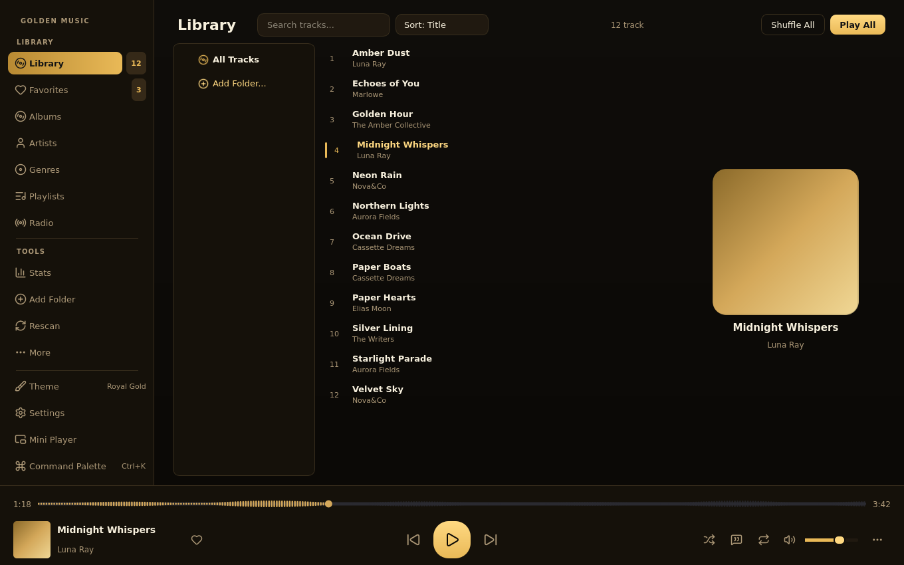</td>
<td>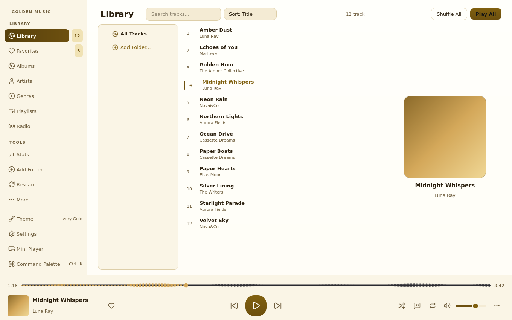</td>
</tr>
<tr>
<td align="center"><b>🌙 Midnight Blue</b></td>
<td align="center"><b>☀️ Clear Azure</b></td>
</tr>
<tr>
<td>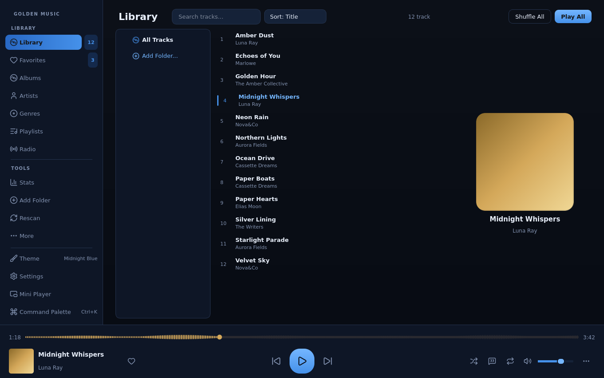</td>
<td>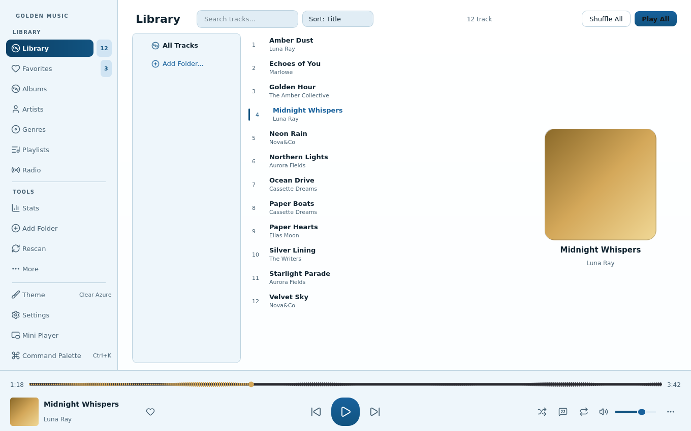</td>
</tr>
<tr>
<td align="center"><b>🔮 Deep Amethyst</b></td>
<td align="center"><b>💜 Soft Lilac</b></td>
</tr>
<tr>
<td></td>
<td>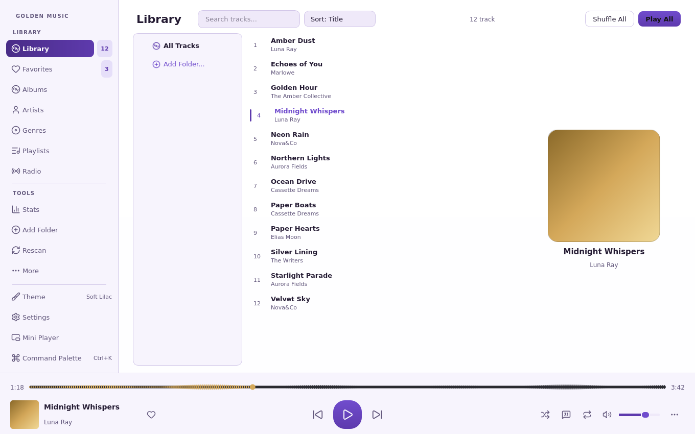</td>
</tr>
<tr>
<td align="center"><b>🌹 Neon Rose</b></td>
<td align="center"><b>🌸 Rose Blush</b></td>
</tr>
<tr>
<td>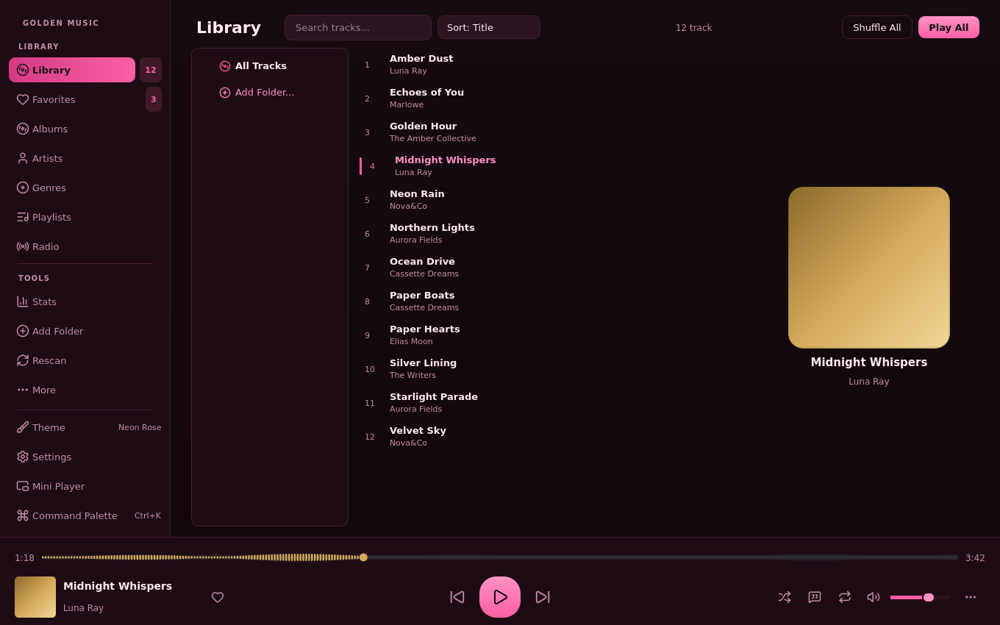</td>
<td>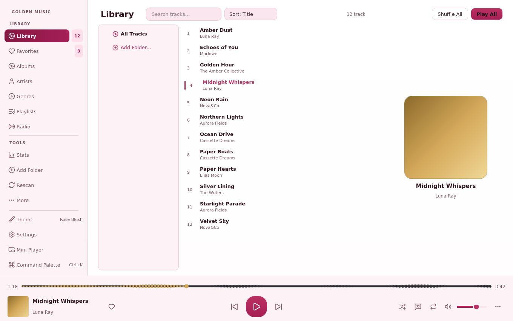</td>
</tr>
<tr>
<td align="center"><b>🌲 Emerald Night</b></td>
<td align="center"><b>🌿 Fresh Sage</b></td>
</tr>
<tr>
<td>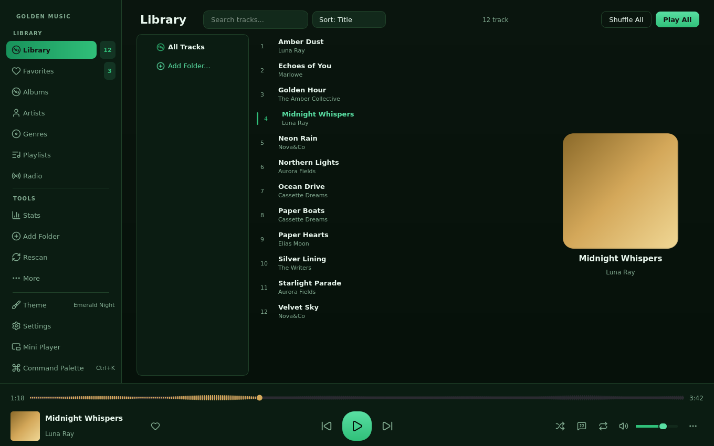</td>
<td>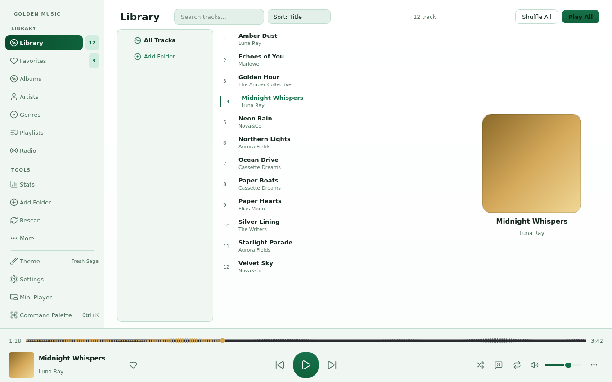</td>
</tr>
<tr>
<td align="center"><b>🖤 Obsidian Black</b></td>
<td align="center"><b>🤍 Porcelain White</b></td>
</tr>
<tr>
<td>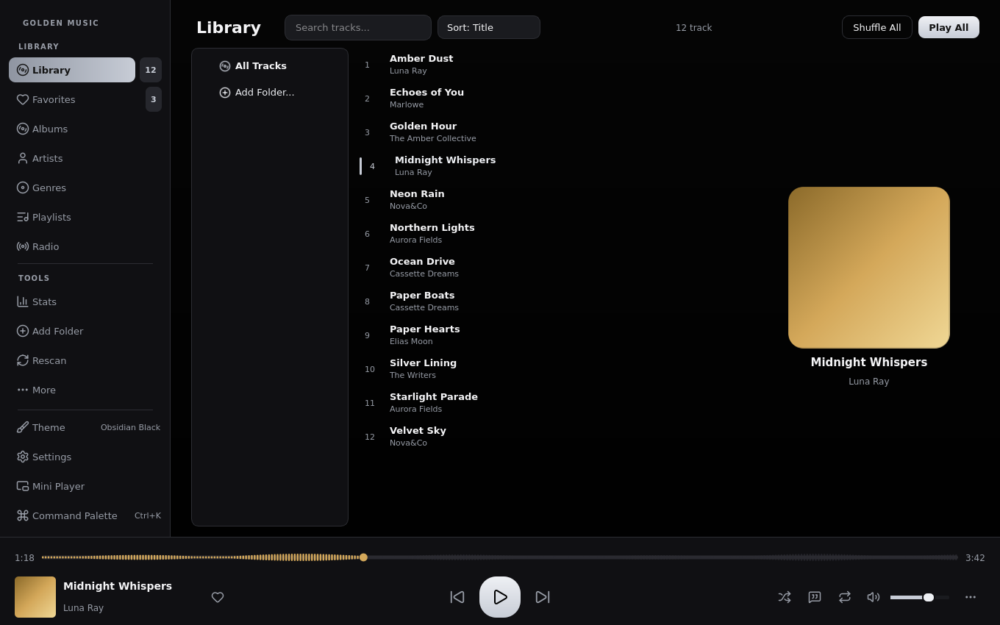</td>
<td>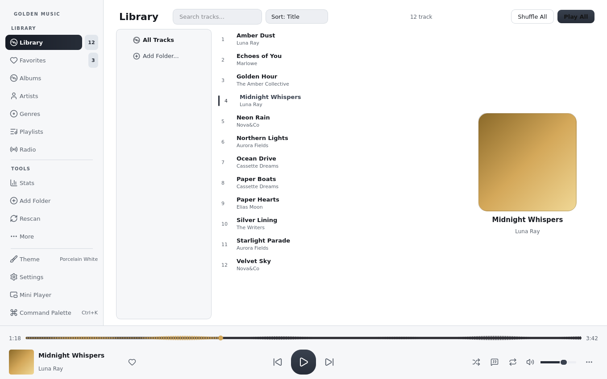</td>
</tr>
</table>

*All twelve theme palettes, captured live from the app — the v3 redesign restyles every control around these same twelve palettes (fresh v3 UI captures coming soon).*

---

## ✨ Highlights

### ⚡ A library that keeps up with you

The whole library now lives in an **SQLite database with FTS5 full-text
search** — instant prefix search over title / artist / album / genre
(diacritics folded), incremental writes instead of whole-file rewrites, and
a design tested for **100k+ track** libraries. Big lists render progressively
(60 rows per tick), so scrolling stays smooth no matter how much music you
have.

- **Track list, your way** — classic rows or a virtual **table view** with
  user-selectable columns (#, Title, Artist, Album, Genre, Duration, Rating,
  Bitrate, Plays, File) and a density setting
- **Albums / Artists / Genres pages** — grid or list, search & sort, and
  detail views with a big cover plus Play All / Shuffle
- **Favorites with your own categories**, 1–5 **star ratings** (stored in
  the app *and* written to file tags where supported) and opt-in **smart
  playlists** (Most Played / Recently Added / Never Played / Not Heard
  Recently / Top Rated)
- **M3U/M3U8 import & export**, live **folder watching**, and an Up Next
  queue with drag-and-drop reordering and bulk actions

### 🎵 Playback that feels right

- **All popular formats** — MP3, WAV, FLAC, OGG, OGA, Opus, M4A, AAC, WMA (FFmpeg-backed)
- **Engine layer with graceful fallback** — an optional libmpv engine
  (python-mpv) slots in beside the Qt engine and is picked up automatically
  when present
- **Real gapless playback and real crossfade** (0–12 s, equal-power curves)
  via a dual-engine coordinator — on *any* engine
- **10-band equalizer** with presets (Flat / Bass Boost / Rock / Night /
  Vocal / Treble Boost / Custom — requires the mpv engine, clearly labeled)
- **ReplayGain loudness normalization** (optional, cached), **pitch-preserving
  playback speed** and optional **silence skipping**
- **Bookmarks & auto-resume** for long files — perfect for audiobooks
- **Internet radio & URL streams** (M3U/HLS) with saved stations
- **Waveform seekbar** (background peaks via optional miniaudio, cached in
  SQLite) and a **real FFT spectrum analyzer** computed from the actual audio
  being played
- **Smart shuffle** — tracks you haven't played this session come first;
  everything gets a turn before anything repeats — plus history-aware Previous
- **A-B Repeat & playback speed**, smooth volume fades, sleep timer
- **OS media controls** — Windows SMTC + global media keys, Linux MPRIS

### 🎨 A theme for every mood — built on color psychology

**Six dark themes** (black-dominant, OLED-friendly) and **six light themes**
(white-dominant, high readability), each pairing a monochrome base with one
accent hue — gold, blue, purple, pink, green or pure silver/graphite. Every
palette was contrast-checked so text stays readable on both OS dark and light
mode.

| 🌑 Dark | ☀️ Light |
|---|---|
| **Royal Gold** — luxury, confidence | **Ivory Gold** — warmth, quiet prestige |
| **Midnight Blue** — nocturnal calm, trust | **Clear Azure** — trust, concentration |
| **Deep Amethyst** — mystery, imagination | **Soft Lilac** — creativity, mindfulness |
| **Neon Rose** — bold, modern energy | **Rose Blush** — compassion, playfulness |
| **Emerald Night** — nature, tranquility | **Fresh Sage** — balance, lowest eye strain |
| **Obsidian Black** — rest & discipline | **Porcelain White** — clarity, Swiss-grid focus |

Open the swatch picker with the **brush button** or `Ctrl+P`, enable *Auto
theme* to follow your OS dark/light mode — or let the optional **dynamic
Material You-style theme** derive a fresh palette from the current album
cover (Settings → Appearance).

### 🧭 A redesigned interface (v3)

- A full **QSS design system** — typography scale, 10 px radii, layered
  surfaces, hover/press states everywhere, modern scrollbars, menus,
  tooltips, tabs and tables
- **Command palette** (`Ctrl+K`) — every app command plus fuzzy search of
  your tracks and albums
- **Rebindable shortcuts** with conflict detection, **UI scale**
  (0.75×–1.5×), and a "Reduce animations" setting
- A rebuilt **Settings dialog** — 10 categories with live search across
  every settings row
- Labeled **sidebar with badges**, skeleton loading rows, friendly empty
  states, and a glassy tray popup that always sits exactly above the
  taskbar

### 🎤 Lyrics that actually match

A much stronger search chain — filename/tag cleanup (leading track numbers,
underscores, site spam), Windows-1256 mojibake repair, Persian/Arabic
normalization, fuzzy matching with duration proximity — plus quality
detection that flags short/spam/URL-laden text before you save it.
Per-track **offsets**, a full **lyrics editor** (text + LRC timing), save to
**file tag and/or `.lrc` sidecar**, **bilingual by-line translations** with
RTL-correct rendering, a **floating desktop lyrics widget**, and a
**Persian UI + RTL layout** option.

### 📊 Your listening, visualized

Plays-over-time lines, minutes-per-month bars, top artists/genres charts, an
expandable top-tracks list (10 → 100) with Play + ♥ per row, a daily
listening heatmap, and a yearly **Wrapped-style report** you can export and
share.

### 🛡️ Reliability by design

- **Verified, rollback-safe migration** — the first 3.0 start backs up your
  legacy JSON data (`backups/pre_sqlite_<timestamp>/`), migrates it to
  SQLite in one atomic transaction and verifies row counts; any failure
  rolls back to legacy JSON mode. Original files are never deleted
- **Cross-platform** — a platform abstraction layer with the full test
  matrix running on Windows *and* Linux in CI; Windows-first features
  degrade gracefully elsewhere
- **Auto-update** — SHA-256-verified installers from GitHub Releases,
  checked at most once a day (Settings → Integrations)
- **Single-instance** — relaunching reveals the running window (even when
  it's hidden in the tray) and hands over any files the OS asked it to open
- **"Open with" integration** — the installer can register the player in
  Explorer's Open-with menu; opened files play as an ad-hoc queue
- **Crash guard**, rotating file log, validated config loading — and async
  everything: no UI freezes even with huge libraries

---

## ⌨️ Keyboard Shortcuts

| Shortcut | Action |
|----------|--------|
| `Ctrl + K` | Command palette (commands + fuzzy track/album search) |
| `Ctrl + P` | Theme picker |
| `Ctrl + L` | Lyrics panel |
| `Ctrl + Q` | Up Next queue |
| `Ctrl + B` | Like the current track |
| `Ctrl + R` | Rate the current track |
| `Space` / `Enter` | Play / Pause (only when no list/input has focus) |
| `Ctrl + ←` | Previous track |
| `Ctrl + →` | Next track |
| `Ctrl + ↑` | Volume Up |
| `Ctrl + ↓` | Volume Down |
| `←` / `→` (neutral focus) | Previous / Next track |
| `↑` / `↓` (neutral focus) | Volume Up / Down |
| `Ctrl + F` | Focus search bar |
| `Ctrl + M` | Toggle Mini Player |
| `Ctrl + J` | Jump to the playing track |
| `F11` / `F` | Fullscreen player (Esc leaves) |
| `Esc` | Leave the fullscreen player |

*Every shortcut is rebindable — with conflict detection — in
Settings → Shortcuts. Media keys (Play/Pause/Stop/Next/Prev) on your
keyboard or headset work globally.*

---

## 🚀 Quick Start

### Option 1: Download Installer (Windows, Recommended)

1. Go to [Releases](../../releases)
2. Download `GoldenMusicSetup-3.0.0.exe`
3. Run the installer — it detects an existing installation and updates in place; your library, favorites, ratings and settings are preserved (the first 3.0 start migrates your data to SQLite — backed up and verified)
4. Enjoy your music! 🎉

Linux users: see [INSTALLATION.md](INSTALLATION.md) for the run-from-source
and packaging routes.

### Option 2: Run from Source (Windows)

```bash
# Clone the repository
git clone https://github.com/Amirmpm/golden-music.git
cd golden-music

# Install dependencies
pip install -r requirements.txt

# On Windows, pywin32 adds media keys + single-instance
pip install pywin32

# Run
python main.pyw
```

### Option 2b: Run from Source (Linux)

```bash
git clone https://github.com/Amirmpm/golden-music.git
cd golden-music

# Qt system libraries (Debian/Ubuntu) + an audio stack
sudo apt install libegl1 libgl1 libxkbcommon0 libdbus-1-3 libfontconfig1
# audio: pipewire (with pipewire-pulse) or pulseaudio — most desktops already have one

pip install -r requirements.txt
python main.pyw
```

**Optional extras** (everything degrades gracefully without them — details in
[INSTALLATION.md](INSTALLATION.md)):

```bash
pip install miniaudio    # waveform seekbar + spectrum analyzer
pip install python-mpv   # EQ, silence-skip, pitch-preserving speed (needs system libmpv)
pip install qrcode       # QR pairing page for the Web Remote
```

### Option 3: Build the Portable exe / Installer Yourself

**Prerequisites:**
- [Python 3.11+](https://www.python.org/downloads/)
- [Inno Setup 6](https://jrsoftware.org/isdl.php) (installer only)

```bash
# Optimized portable build (trims unused Qt DLLs, enforces a size budget)
python build_release.py

# Full pipeline: tests -> exe -> installer
build_windows.bat
```

Output:
- `dist\GoldenMusic\GoldenMusic.exe` — The app (portable folder)
- `dist\installer\GoldenMusicSetup-3.0.0.exe` — The installer

---

## 📁 Project Structure

```
golden-music/
├── main.pyw / main.py       # Thin entry points (double-click / importable)
├── gm/                      # The application package (v3)
│   ├── core.py              # Shared state, enums, helpers
│   ├── window.py / app.py   # MainWindow + app bootstrap
│   ├── platforms.py         # Cross-platform OS layer (Windows/Linux/macOS)
│   ├── db.py / store.py     # SQLite library (WAL + FTS5) + facades
│   ├── migration.py         # Verified JSON → SQLite migration
│   ├── player_adapter.py / audio_engines.py   # Engine layer (mpv → Qt fallback)
│   ├── equalizer / crossfade / normalize /    # DSP-style playback extras
│   │   silence_skip / waveform / spectrum
│   ├── lyrics_*.py          # Search, quality, editor, translations, flow
│   ├── webremote.py / telegrambot.py / mpris.py / remote_bridges.py
│   ├── workers.py           # Background threads (scan, tags, covers)
│   ├── i18n.py / prefs.py / theme_qss.py / dynamic_theme.py / m3u.py / smart.py
│   └── ui/                  # sidebar, command_palette, pages3, settings3,
│                            #   stats3, lyrics_ui, player_bar, widgets, ...
├── config.py, icons.py, scanner.py, coverart.py, applog.py, ...
│                            # Shared v2-era modules still in daily use
│                            #   (themes/QSS, icons, scanning, logging, ...)
├── scripts/                 # 23 offline test suites + tooling
├── docs/DECISIONS.md        # Architecture decision log
├── requirements.txt         # Hard deps + documented optional extras
├── goldenmusic.spec         # PyInstaller spec (optimized)
├── goldenmusic.iss          # Inno Setup installer script
├── build_release.py         # Optimized exe build + optional code signing
├── build_windows.bat        # One-click: tests -> exe -> installer
├── .github/workflows/       # CI: Windows+Linux matrices, Bandit, build
├── assets/                  # App icon, logo, Lucide SVG icon set
├── screenshots/             # App screenshots for README
├── LICENSE                  # MIT License
└── CONTRIBUTING.md / CHANGELOG.md / INSTALLATION.md
```

---

## 🎨 Themes in depth

Golden Music v3 keeps the **color-psychology suite** introduced in v2.0 —
six black-dominant dark themes and six white-dominant light themes,
monochrome plus gold, blue, purple, pink and green — and rebuilds every
control around it with a proper QSS design system (`gm/theme_qss.py`): a
typography scale, 10 px radii, layered surfaces, hover/press states, modern
scrollbars, menus, tooltips, tabs and tables. Every palette passed WCAG
contrast verification before shipping, and light themes stay readable even
when the OS itself runs in the opposite mode.

Open the swatch picker (**brush icon** or `Ctrl+P`) to switch instantly —
or enable *Auto theme* to follow your OS dark/light mode, or the optional
dynamic Material You-style theme derived from the current album cover
(Settings → Appearance).

---

## 🛠️ Tech Stack

| Technology | Purpose |
|------------|---------|
|  | Core language |
|  | GUI framework |
|  | Library database & full-text search |
|  | Audio metadata |
| libmpv *(optional)* | EQ / crossfade / silence-skip audio engine |
| miniaudio *(optional)* | Waveform seekbar & spectrum decoding |
|  | EXE packaging |
|  | Windows installer |

---

## 📦 Configuration

Golden Music stores its data at `%USERPROFILE%\.goldenmusic\` on Windows
(`~/.goldenmusic/` on Linux):

```
~/.goldenmusic/
├── library.db           # SQLite library: tracks, tags, FTS index, favorites,
│                        #   playlists, ratings, play history, bookmarks,
│                        #   radio stations, waveform cache
├── config.json          # App settings & preferences
├── lyrics_cache/        # Cached lyrics
├── backups/             # Automatic backups (incl. pre_sqlite_<timestamp>/)
└── goldenmusic.log      # Rotating diagnostics log
```

*Portable mode:* if a `goldenmusic_config.json` sits next to the executable
(or `main.pyw`), the app stores everything in that folder instead — handy for
USB-stick installs.

**What's stored:**
- Library tracks with tags, favorites, playlists, ratings and play history
  (in `library.db`)
- Last played track and position; bookmarks for long files
- Volume, theme, shuffle/repeat state, window geometry
- All settings preferences

On the first 3.0 start, legacy `config.json` / `tag_cache.json` /
`stats.json` library data is migrated into `library.db` — backup-first,
verified, and rollback-safe (the originals are never deleted).

---

## 📡 Remote Control (optional — off by default)

- **Web Remote** — a LAN-only web server built on the Python standard
  library (no extra dependencies) with token authentication (constant-time
  compare), a QR pairing page, per-IP rate limiting and a mobile-friendly
  offline single-page UI. Enable it in Settings → Integrations, then open
  the pairing URL on your phone
- **Telegram bot** — control playback with `/play` `/pause` `/next` `/prev`
  `/status` `/volume` `/search` `/list` from any chat. You supply your own
  bot token and allow-list the user IDs that may use it (Settings →
  Integrations)

Both remotes are **disabled by default** and never touch Qt objects from
their worker threads — every action is queued onto the GUI thread.

---

## 🤝 Contributing

**We welcome contributions from everyone!** 🎉

Golden Music is an open-source project and we'd love your help to make it even better. Whether you're a developer, designer, translator, or just have a great idea — there's a place for you here.

- 🐛 [Report bugs](../../issues/new?template=bug_report.md)
- 💡 [Suggest features](../../issues/new?template=feature_request.md)
- 🔧 [Submit pull requests](CONTRIBUTING.md)
- ⭐ Star the repo if you find it useful!

See [CONTRIBUTING.md](CONTRIBUTING.md) for development setup and guidelines.

---

## 📄 License

This project is licensed under the MIT License — see [LICENSE](LICENSE) for details.

---

<div align="center">

**Made with 🎵 and ❤️ for Windows & Linux**

⭐ Star this repo if Golden Music makes your listening better!

</div>
